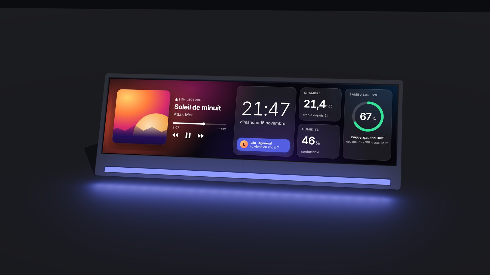
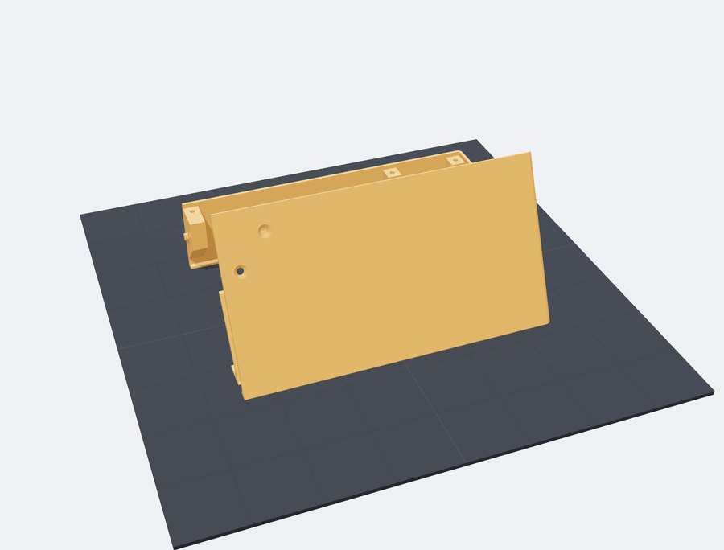
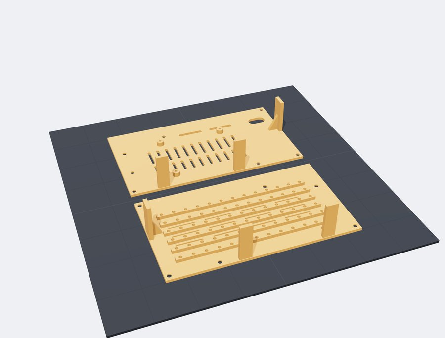
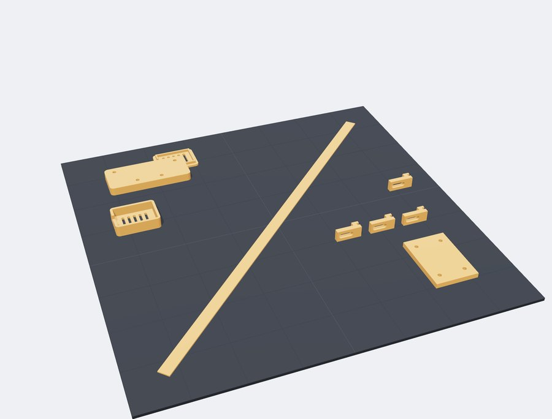
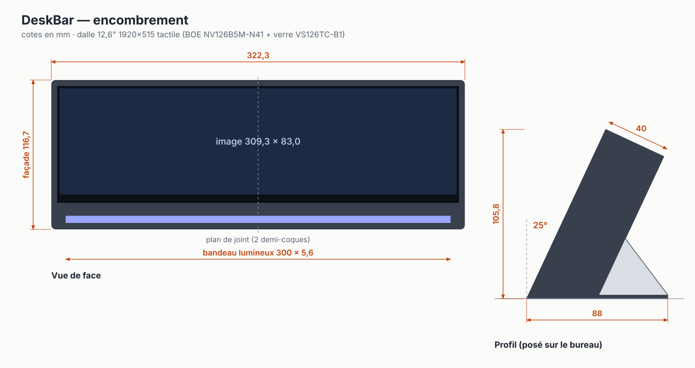
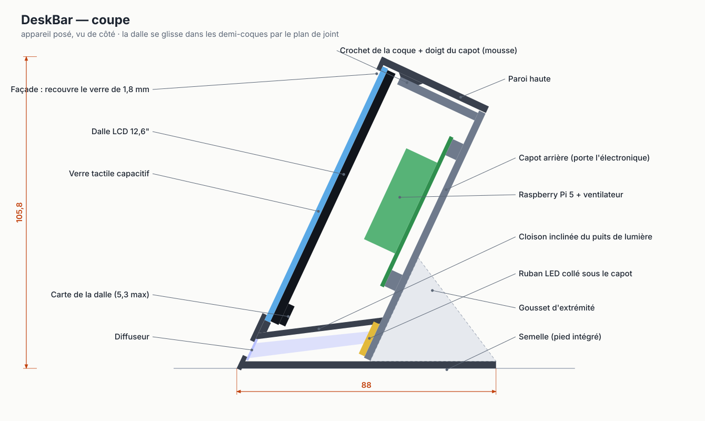
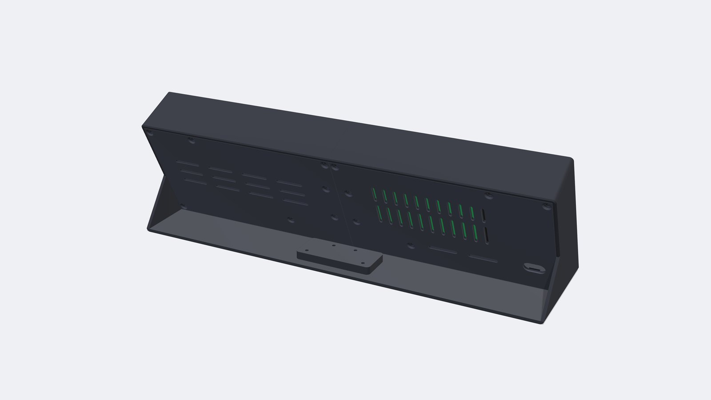
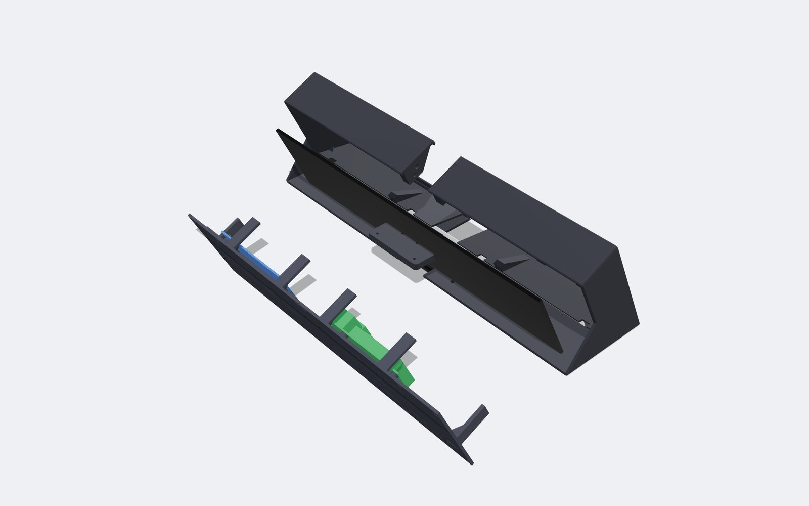
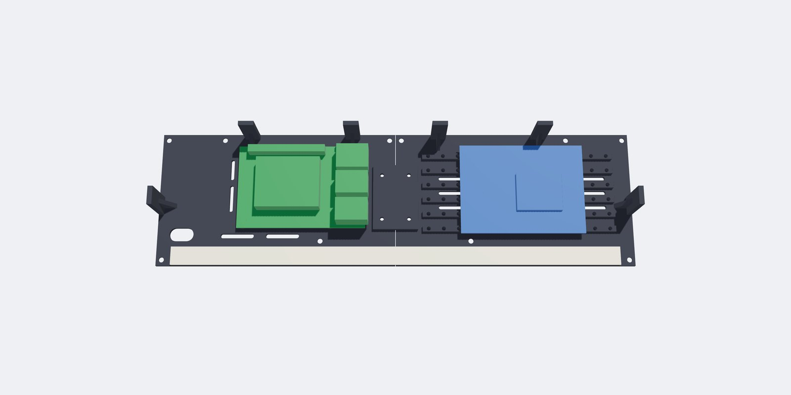
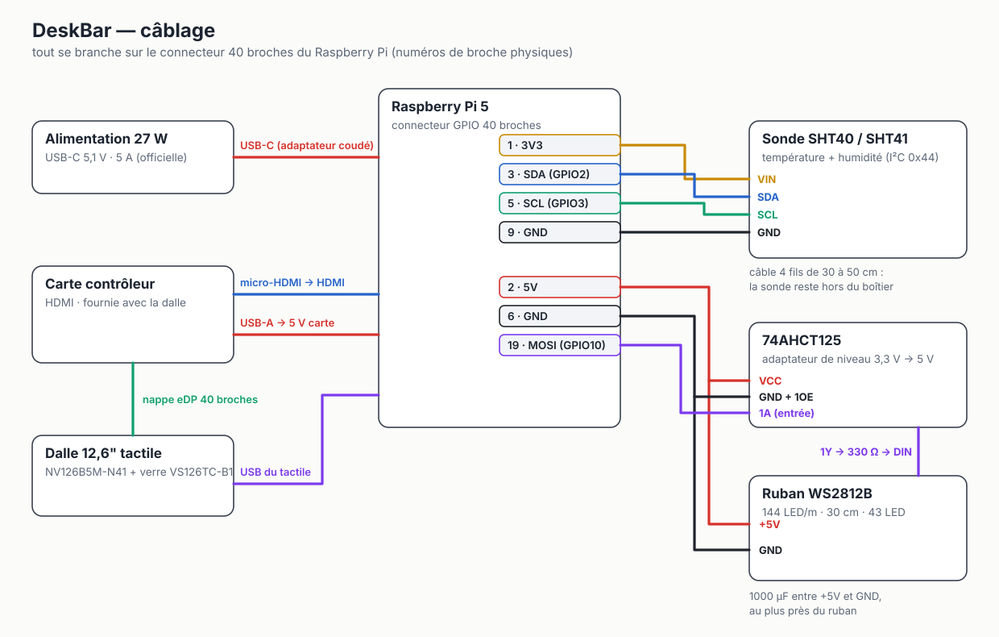

# DeskBar — écran de bureau personnalisable à imprimer en 3D

Un écran « bar » de 12,6" (1920 × 515) qui se glisse sous le moniteur principal : musique en cours, température
et humidité de la chambre, avancement de l'impression Bambu Lab, notifications Discord, et un bandeau lumineux
intégré sous l'image pour les notifications. Tout le boîtier s'imprime sur une Bambu Lab P2S (plateau 256 mm).



> L'image à l'écran est une **maquette** de l'interface (voir `docs/maquette_interface.png`). Le logiciel est
> l'étape suivante, il n'est pas encore dans ce dossier.

| | |
|---|---|
| Encombrement posé | 321 mm de large × 104 mm de haut × 88 mm de profondeur, écran incliné de 25° |
| Budget | ≈ 245 € tout compris (≈ 280 € avec un Raspberry Pi 5 2 Go, ≈ 160 € branché au PC) |
| Impression | ≈ 370 g de filament, ≈ 13 h sur 4 plateaux, sans support |
| Outils | clé Allen 2,5 mm, tournevis cruciforme, fer à souder (3 fils du ruban LED) |

## 1. Liste de courses et budget

Prix TTC relevés ou estimés en novembre 2026. Les prix du Raspberry Pi ont beaucoup monté en 2026 (pénurie de
mémoire), d'où le choix du modèle 1 Go.

| # | Pièce | Détail à respecter | Prix |
|---|---|---|---|
| 1 | Dalle 12,6" 1920 × 515 IPS + carte contrôleur | Dalle **BOE NV126B5M-N41**, kit avec carte HDMI **alimentée en 5 V par USB** (pas la version 12 V) | ≈ 100 € |
| 2 | Raspberry Pi 5 **1 Go** | Suffit pour l'affichage plein écran ; le 2 Go est plus confortable | ≈ 55 € |
| 3 | Alimentation officielle Raspberry Pi 27 W USB-C | Alimente le Pi, l'écran et les LED | ≈ 14 € |
| 4 | Carte microSD 32 Go (classe A1) | | ≈ 9 € |
| 5 | Ventilateur officiel « Active Cooler » Pi 5 | Le Pi est enfermé, il faut le ventiler | ≈ 6 € |
| 6 | Nappe HDMI plate, 20 cm, connecteurs coudés | micro-HDMI côté Pi → mini-HDMI ou HDMI selon ta carte contrôleur | ≈ 8 € |
| 7 | Adaptateur USB-C coudé à 90° | Pour brancher l'alimentation dans le boîtier | ≈ 4 € |
| 8 | Ruban LED **WS2812B, 5 V, 144 LED/m**, IP30, 1 m | On en utilise 30 cm (43 LED), largeur 12 mm maxi | ≈ 11 € |
| 9 | Capteur **SHT40** (ou SHT41) sur petite carte I²C | Température + humidité | ≈ 5 € |
| 10 | 74AHCT125 + résistance 330 Ω + condensateur 1000 µF | Rend le signal des LED fiable | ≈ 4 € |
| 11 | Fils Dupont femelle-femelle 20 cm | Capteur et LED vers le Pi | ≈ 4 € |
| 12 | Visserie : assortiment M3 + M2,5 | Voir le détail ci-dessous | ≈ 10 € |
| 13 | Mousse adhésive 3 mm + 4 patins antidérapants | Cale la dalle sans la contraindre | ≈ 5 € |
| 14 | Filament PLA mat noir (≈ 370 g) + un peu de blanc | Le blanc sert au diffuseur (2 g) | ≈ 8 € |
| | **Total** | | **≈ 243 €** |

Ce qui est vérifié et ce qui ne l'est pas :

* **Raspberry Pi 5 1 Go** : relevé entre 50,70 € et 59,90 € chez les revendeurs français, mais le stock est irrégulier.
  Le 2 Go est passé à 77,50 $ prix public le 1er octobre 2026, soit ≈ 90 € en France.
* **Dalle** : c'est le poste incertain. Le kit est affiché **≈ 130 à 166 € sur Amazon** ; je n'ai pas pu relever
  les prix AliExpress, où ce kit est habituellement nettement moins cher. Les 100 € sont donc une estimation :
  au-dessus de 150 €, le total dépasse 290 €.
* Les autres lignes sont des ordres de grandeur.

Deux variantes :

* **Confort (≈ 280 €)** : Raspberry Pi 5 2 Go à la place du 1 Go.
* **Branché au PC (≈ 160 €)** : pas de Raspberry Pi ; l'écran est un deuxième moniteur HDMI du PC, et un
  ESP32-C3 à 5 € pilote le capteur et les LED en USB. Moins cher, mais l'écran s'éteint avec le PC. Le boîtier
  est le même.

Visserie nécessaire : 14 vis M3×8 tête fraisée, 4 vis M3×6 tête fraisée, 4 vis M3×8 tête bombée, 1 vis M3×16
tête cylindrique à six pans creux avec son écrou, 4 vis M2,5×6. Toutes les vis se vissent directement dans le
plastique, il n'y a pas d'insert à poser.

## 2. Ce qu'il faut imprimer

Les fichiers sont dans `stl/` (et `step/` pour les modifier). Ils sont déjà orientés : il suffit de les poser sur
le plateau. « Gauche » et « droite » s'entendent **vu de face**.

| Fichier | Qté | Rôle | Plateau |
|---|---|---|---|
| `00_gabarit_test_gauche` / `_droite` | 1 + 1 | Les 8 premiers millimètres des coques, pour vérifier la dalle avant le vrai tirage | essai |
| `01_coque_gauche` | 1 | Demi-coque avant : façade, puits de lumière, semelle | 1 |
| `02_coque_droite` | 1 | Idem, côté droit | 2 |
| `03_capot_pi` | 1 | Demi-capot arrière, porte le Raspberry Pi | 3 |
| `04_capot_controleur` | 1 | Demi-capot arrière, porte la carte de l'écran | 3 |
| `05_diffuseur` | 1 | Lame blanche de 0,8 mm du bandeau lumineux | 4 |
| `06_eclisse_capot` | 1 | Réunit les deux demi-capots | 4 |
| `07_eclisse_pied` | 1 | Réunit les deux semelles à l'arrière | 4 |
| `08_griffe_carte` | 4 | Brides réglables pour la carte contrôleur | 4 |
| `09_boitier_sonde` + `10_couvercle_sonde` | 1 + 1 | Petit boîtier ajouré du capteur | 4 |

| Plateau 1 | Plateau 3 | Plateau 4 |
|---|---|---|
|  |  |  |

Réglages Bambu Studio :

* Profil **0,20 mm Standard**, buse 0,4 mm, 3 parois, remplissage 15 % gyroïde, **sans support** (tous les
  porte-à-faux sont à 45° ou moins).
* **Plateau PEI texturé** : la façade des coques s'imprime contre le plateau et garde son grain mat.
* PLA mat noir pour tout sauf le diffuseur, en PLA blanc. Si le bureau est au soleil, préfère le PETG.
* Le diffuseur fait 299 mm : il est fourni tourné à 45° pour tenir en diagonale sur le plateau.

## 3. Plans





Le boîtier fait 321 mm de large : il ne tient pas sur un plateau de 256 mm, il est donc coupé en deux demi-coques
boulonnées au milieu. Les deux façades s'impriment contre le même plateau, ce qui donne un joint fin et régulier.

| Vue de dos | Vue éclatée |
|---|---|
|  |  |

## 4. À vérifier à la réception de la dalle

Le boîtier est dessiné d'après la fiche technique de la dalle, **je n'ai pas pu le présenter sur une dalle
réelle**. Avant de lancer les deux grosses coques (≈ 8 h), imprime les deux gabarits (≈ 1 h) et contrôle :

1. **Contour** : la dalle (315,6 × 94,0 mm attendus) se glisse dans les gabarits par le milieu, sans forcer.
2. **Épaisseur au bord haut** : elle passe sous les crochets (prévus pour une dalle de 3,0 à 3,8 mm au bord).
3. **Position de l'image** : écran allumé, l'image doit être entièrement visible dans la fenêtre. Le plan suppose
   3,15 mm de bord noir en haut et 7,9 mm en bas ; ces deux valeurs ne figurent pas dans la fiche technique.
4. **Carte contrôleur** : elle doit tenir dans 130 × 60 mm et s'alimenter en 5 V.

Si une cote diffère, donne-moi tes mesures : elles se règlent en tête de `cad/deskbar.py` (`PANEL_W`, `PANEL_H`,
`PANEL_T_EDGE`, `BORDER_TOP`) et tout se régénère en une commande.

## 5. Montage



1. **Capot** : réunis les deux demi-capots avec l'éclisse (4 vis M3×6 fraisées, depuis l'extérieur). Visse le
   Raspberry Pi sur ses 4 entretoises (M2,5×6), ports USB-C et HDMI vers le bas. Bride la carte contrôleur sur les
   nervures perforées avec les 4 griffes (M3×8 bombées). Colle le ruban LED le long du bord bas du capot.
2. **Coques** : pose la coque gauche façade contre un chiffon, glisse la dalle dedans **par le plan de joint**,
   écran vers le bas, bord haut sous les crochets. Enfile la coque droite sur l'autre moitié de la dalle. Serre le
   boulon central (M3×16 + écrou, clé Allen), puis visse l'éclisse de pied par dessous (4 vis M3×8 fraisées).
3. **Diffuseur** : dépose-le au fond du puits de lumière par l'arrière, avec un point de colle.
4. **Câblage** : branche la nappe eDP de la dalle sur la carte contrôleur, la nappe HDMI, l'USB d'alimentation de
   l'écran, les fils du ruban (par les encoches de la cloison) et le capteur.
5. **Fermeture** : colle un morceau de mousse au bout des 6 doigts du capot (ils plaquent la dalle contre la
   façade), puis visse le capot (10 vis M3×8 fraisées). Le câble d'alimentation et celui de la sonde sortent par
   la lumière ovale en bas du capot.
6. Colle les 4 patins sous la semelle. La sonde se pose à 30 cm au moins, hors du flux d'air chaud.

## 6. Câblage



| Fil | Broche du Pi | Vers |
|---|---|---|
| 3,3 V | 1 | VIN du SHT40 |
| SDA | 3 | SDA du SHT40 |
| SCL | 5 | SCL du SHT40 |
| Masse | 9 | GND du SHT40 |
| 5 V | 2 | VCC du 74AHCT125 et +5V du ruban |
| Masse | 6 | GND + 1OE du 74AHCT125, GND du ruban |
| GPIO10 (MOSI) | 19 | entrée 1A du 74AHCT125 ; sortie 1Y → 330 Ω → DIN du ruban |

Le ruban est alimenté par le Pi : la luminosité sera plafonnée à ≈ 35 % dans le logiciel (moins de 1 A), ce qui
reste très lumineux derrière le diffuseur.

## 7. Logiciel (étape suivante)

Prévu : Raspberry Pi OS Lite, un navigateur plein écran et une page web qui sert de tableau de bord, donc
entièrement personnalisable (HTML/CSS). Sources de données envisagées :

* **Musique** : titre, pochette et avancement via l'API de ton service de streaming.
* **Température / humidité** : lecture du SHT40 en I²C.
* **Bambu Lab P2S** : état et avancement lus sur le réseau local (MQTT, avec le code d'accès de l'imprimante).
* **Discord** : Discord ne fournit pas d'API pour lire les notifications d'un compte. La voie propre est un petit
  programme sur le PC qui relaie les notifications Windows de Discord vers l'écran.
* **Bandeau LED** : une couleur par source, et une barre de progression pendant les impressions.

## 8. Modifier le modèle

```bash
pip install cadquery
cd cad
python3 deskbar.py     # régénère stl/ et step/
python3 plans.py       # régénère les plans de docs/
```

Tous les réglages (dalle, jeux, inclinaison `THETA`, profondeur du pied `FOOT`, position du Raspberry Pi) sont
regroupés en tête de `cad/deskbar.py`.
